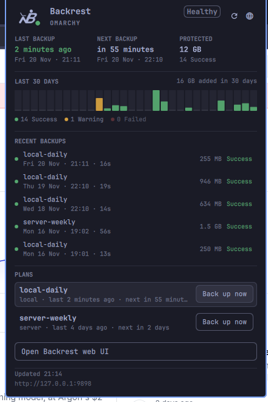
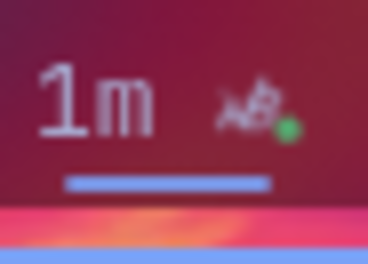
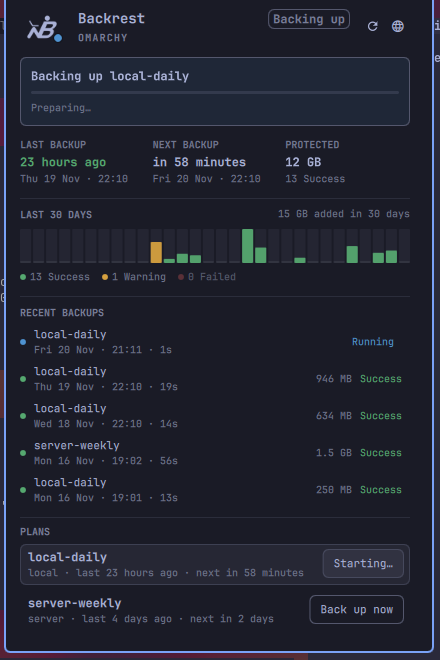
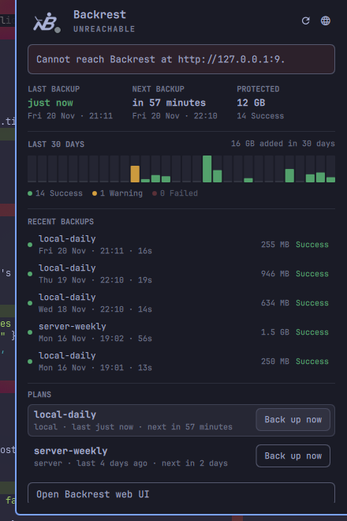

# Backrest for Omarchy

An [Omarchy](https://omarchy.org/) bar widget for [Backrest](https://github.com/garethgeorge/backrest) that keeps backup health visible at a glance, shows a compact history, and starts a backup without opening the web UI.



## Features

- **Status at a glance** — the Backrest mark carries a colored dot: green for healthy, amber for a warning or an overdue schedule, red for a failed backup, blue and pulsing while a backup is running, grey when Backrest is unreachable.
- **Last backup age in the bar** — a compact `1m`, `3h`, or `2d` next to the icon (can be turned off).
- **30-day history** — one bar per day, colored by the worst outcome of that day and scaled by the amount added, plus success/warning/failed counts.
- **Recent backups** — the last five runs with plan, date, duration, data added, and outcome.
- **One-click backups** — every plan gets a *Back up now* button. Live progress appears while a backup runs.
- **Keyboard driven** — arrows move through the plans, `Enter`/`Space` starts the selected backup, `r` refreshes, `o` opens the Backrest web UI, `Esc` closes the panel.
- **Auth aware** — works with Backrest authentication disabled, with a bearer token, or with a username/password login. The token is kept in memory only.
- **English and Italian** — the panel follows Omarchy's language setting.

## Requirements

- Omarchy with the Quickshell shell.
- A reachable Backrest 1.x instance (defaults to `http://127.0.0.1:9898`).
- `curl` (present on a standard Omarchy install).

## Install

```bash
omarchy plugin add https://github.com/lorenzo-vecchio/omarchy-backrest --enable
```

The widget is placed in the right section of the bar. If needed:

```bash
omarchy bar move io.github.lorenzo-vecchio.backrest --section right
```

For local development, place this repository at
`~/.config/omarchy/plugins/io.github.lorenzo-vecchio.backrest` with your usual
git workflow, then load it:

```bash
omarchy-shell shell rescanPlugins
omarchy plugin enable io.github.lorenzo-vecchio.backrest right
```

## Remove

```bash
omarchy plugin remove io.github.lorenzo-vecchio.backrest
```

## Configure

Use the widget settings in Omarchy, or edit the widget entry in `~/.config/omarchy/shell.json`:

```json
{
  "id": "io.github.lorenzo-vecchio.backrest",
  "serverUrl": "http://127.0.0.1:9898",
  "refreshIntervalSec": 30,
  "showAge": true
}
```

| Key | Default | Meaning |
|-----|---------|---------|
| `serverUrl` | `http://127.0.0.1:9898` | Base URL of the Backrest web UI. `http` is accepted only for localhost; remote servers must use `https`. |
| `refreshIntervalSec` | `30` | Polling interval. While a backup is running the widget polls every 5 seconds. |
| `showAge` | `true` | Show the last backup age next to the bar icon. |
| `authToken` | empty | Bearer JWT. Preferred when Backrest authentication is enabled. |
| `username` | empty | Used to log in only when no bearer token is set. |
| `password` | empty | Stored in plain text in `shell.json`; prefer a bearer token. |

### Authentication

With Backrest authentication enabled, set `authToken` to a JWT from a Backrest login. Alternatively set `username` and `password`; the widget calls `Authentication/Login` on first use and keeps the returned token in memory for the session.

Credentials are bound to the server URL they were entered for. The binding is remembered across widget and shell restarts in `~/.local/state/omarchy/backrest-credentials.json`, which stores only the server URL and a fingerprint of the credentials — never the token or password. After changing `serverUrl`, re-enter the token or the username and password so they apply to the new server; the widget never offers the previous server's credentials to a different origin. A configured bearer token is also authoritative: if it is rejected, the widget does not fall back to the saved password.

## Controls

| Action | Result |
|--------|--------|
| Left click | Open or close the panel |
| Right click | Open the Backrest web UI |
| Middle click | Refresh now |
| `r` | Refresh now |
| `o` | Open the Backrest web UI |
| `b` / `Enter` / `Space` | Back up the selected plan |
| Up / Down (`k` / `j`) | Move between plans |
| `Esc` | Close the panel |

IPC is also available:

```bash
omarchy-shell io.github.lorenzo-vecchio.backrest status
omarchy-shell io.github.lorenzo-vecchio.backrest toggle
omarchy-shell io.github.lorenzo-vecchio.backrest backup local-daily
```

## Screenshots

| Bar | Running | Offline |
|-----|---------|---------|
|  |  |  |

## What it talks to

The widget only reads from Backrest unless you press a backup button:

- `GetSummaryDashboard` — plan and repository summaries, 30-day history.
- `GetOperations` — detects a running backup, its progress, and the plan-to-repository labels.
- `Backup` — sent only when a plan's *Back up now* button is pressed.
- `Authentication/Login` — sent only when username/password auth is configured.

The widget deliberately does not call `GetConfig`: that response can contain repository passwords and storage environment values, while the display only needs plan and repository identifiers. Requests use a fixed 10-second timeout and curl aborts any response over 8 MiB before it reaches the shell. Every server-provided string is displayed as plain text and no downloaded content is executed.

## Notes

- A running backup switches the status dot to a pulsing blue and opens a progress card with bytes processed when Backrest reports them.
- If Backrest is unreachable, the panel keeps the last known snapshot visible and tells you it is stale.
- The widget does not install, configure, or delete anything in Backrest.

## License

MIT. The Backrest logo in `assets/backrest-symbolic.png` is derived from the [Backrest project](https://github.com/garethgeorge/backrest), MIT licensed.
